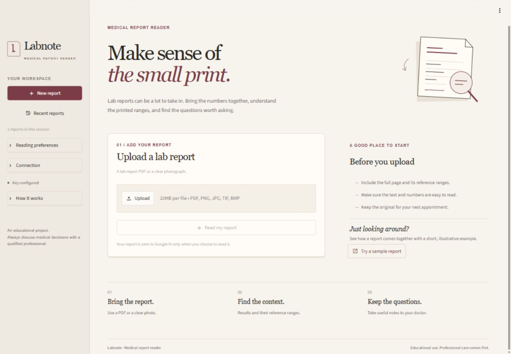

# Labnote

A Streamlit medical report reader that organizes lab results into readable tables, explanatory notes, and downloadable reports. The Python analysis service and the interface are kept in separate modules.



## Quick start

Use Python 3.11 or newer. Run all commands below from the repository root.

On Windows, double-click **Start Project.bat**. It creates a local environment, installs missing app dependencies, and starts the server. Keep its terminal open while using the app.

For manual setup on Windows:

```powershell
python -m venv .venv
.\.venv\Scripts\python.exe -m pip install -r requirements.txt
.\.venv\Scripts\python.exe -m streamlit run app.py
```

On macOS or Linux:

```bash
python3 -m venv .venv
.venv/bin/python -m pip install -r requirements.txt
.venv/bin/python -m streamlit run app.py
```

Open [localhost:8501](http://localhost:8501). Stop the server with Ctrl+C in its terminal.

## Configuration

For a fresh clone, copy `.env.example` to `.env` in the repository root and add your own Google AI key:

```dotenv
GEMINI_API_KEY=your_google_ai_studio_api_key
GEMINI_MODEL=gemini-3.5-flash-lite
```

You can also enter your key in the sidebar's **Connection** section for the current browser session. Refresh the browser after changing `.env`.

The configured model must be available to your Google AI account. Live analysis also depends on your network connection and account quota.

## Read a report

1. Upload a PDF or a clear PNG, JPG, JPEG, TIFF, or BMP image.
2. Choose **Read my report**.
3. Explore **At a glance**, **Test results**, **Notes & next steps**, and **Full report**.
4. Save a Markdown report or JSON data from **Full report**.

**Try a sample report** works without an API key and makes no AI request. Its values and risk labels are explicitly marked as synthetic demonstration output.

Under **Reading preferences**, **Include explanations** controls generated notes, **Allow downloads** controls exports, and **Show trends** enables comparisons across reports for the same named patient with matching tests and units. Extracted results remain available if the optional notes request fails.

**Recent reports** shows the five most recent readings and retains up to 20 in the current browser session. You can reopen a reading or choose **New report** to clear the current upload and results while preserving session history.

Uploaded report content is sent to Google AI when you choose **Read my report**. Text PDFs are extracted locally first. Scanned PDFs without selectable text should be uploaded as images.

This is an educational project. Generated output and training results do not establish clinical validity; discuss medical decisions with a qualified healthcare professional.

## Project structure

```text
.
├── app.py                       # Streamlit entry point
├── labnote/                     # Application package
│   ├── config.py                # Project paths and configuration
│   ├── scanner.py               # Extraction, Gemini analysis, and report generation
│   ├── ui.py                    # Streamlit presentation and session workflow
│   ├── sample_data.py           # Synthetic UI demonstration data
│   └── assets/style.css         # Interface styles
├── tests/                       # API-free regression and UI checks
├── training/                    # Optional CSV model-training pipeline
│   ├── preprocess.py
│   └── train.py
├── data/reports.csv              # Dataset used by the optional training pipeline
├── scripts/                     # Windows startup and runtime helpers
├── docs/screenshots/             # Interface previews
├── .streamlit/config.toml        # Theme and local server settings
├── .env.example                 # Shareable configuration template
├── requirements.txt             # App dependencies
├── requirements-training.txt    # Optional training dependencies
└── Start Project.bat            # Windows launcher
```

`app.py` starts the app directly from the repository root; no editable package installation is required. The training pipeline is independent of the Gemini-powered interface.

## Tests

After installing the app dependencies:

```powershell
.\.venv\Scripts\python.exe -m unittest discover -s tests -v
```

On macOS or Linux, use `.venv/bin/python` instead. The suite covers report extraction, malformed API responses, error handling, sample results, exports, history, and UI state. Configuration and AI clients are mocked; these checks do not use your credentials or send medical data to an API.

## Optional model training

```powershell
.\.venv\Scripts\python.exe -m pip install -r requirements-training.txt
.\.venv\Scripts\python.exe training/preprocess.py
.\.venv\Scripts\python.exe training/train.py
```

The pipeline reads `data/reports.csv` and writes models to `outputs/models/`, evaluation files to `outputs/reports/`, and logs to `outputs/logs/`. These generated files are unnecessary for the Streamlit app. The bundled training CSV is separate from the UI's synthetic demonstration data.
